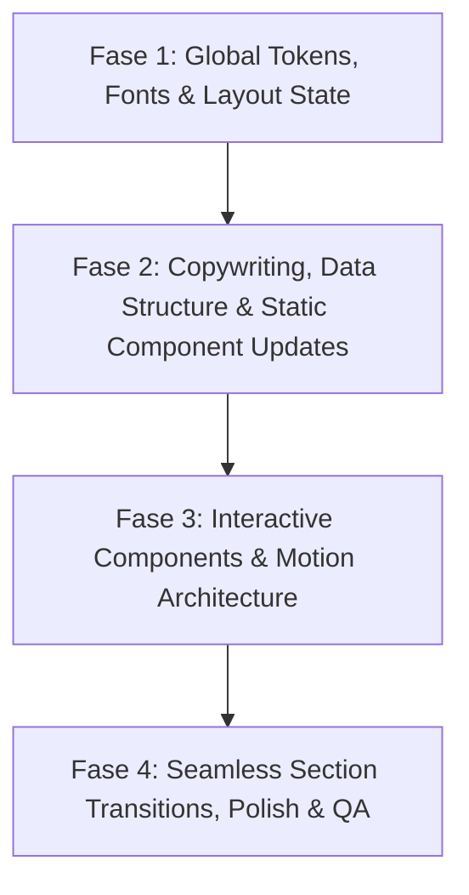

# Implementation Plan — NOMINA Creative Website Feedback Audit (`feedback_screenshot/`)

Dokumen ini memetakan seluruh hasil audit dari **19 slide feedback** di folder `feedback_screenshot/` (`Creative Website Dev-Feedback-images-0.jpg` s/d `18.jpg`) ke dalam arsitektur kode Next.js NOMINA Creative saat ini, tanpa mengubah kode terlebih dahulu.

---

## 1. Ringkasan Audit per Slide / Screenshot & Komponen Terdampak

### Slide 0 — `Creative Website Dev-Feedback-images-0.jpg`
- **Topik:** Cover Dokumen (*Creative Website Development — NOMINA Indonesia Creative*, Reviewed by RFM).
- **Komponen Terdampak:** *Tidak ada (Slide judul).*

---

### Slide 1 — `Creative Website Dev-Feedback-images-1.jpg`
- **Topik:** **Looks & Feel (Moodboard & UI Direction)**
- **Detail Feedback:**
  - Referensi visual menampilkan gaya **Bento Grid modern**, kontras tinggi antara **Branding Orange (`#E85002` / `#FB5102`)**, **Hitam (`#000000`)**, **Putih (`#F9F9F9`)**, dan **Warm Gray (`#CDCDCB`)**.
  - Penggunaan kartu modular dengan statistik besar (`472+`, `597+`, `350+`), tipografi display raksasa sebagai elemen struktural, serta ikon panah di sudut kartu.
- **Komponen / Halaman Terdampak:**
  - Global stylesheet: [globals.css](file:///Users/dicky/Work/nomina-second/src/app/globals.css)
  - Landing Page: [page.tsx](file:///Users/dicky/Work/nomina-second/src/app/page.tsx), [AboutSection.tsx](file:///Users/dicky/Work/nomina-second/src/components/AboutSection.tsx), [ServicesSection.tsx](file:///Users/dicky/Work/nomina-second/src/components/ServicesSection.tsx), [StatementSection.tsx](file:///Users/dicky/Work/nomina-second/src/components/StatementSection.tsx)

---

### Slide 2 — `Creative Website Dev-Feedback-images-2.jpg`
- **Topik:** **Color Palette & Brand Typography**
- **Detail Feedback:**
  - **Color Tokens Utama:**
    - `Branding Orange`: `#E85002` (`rgb(232, 80, 20)`) & Secondary Bright Orange `#FB5102`
    - `Primary Black`: `#000000` (`rgb(0, 0, 0)`)
    - `White`: `#F9F9F9` (`rgb(249, 249, 249)`)
    - `Gray`: `#646464` (`rgb(100, 100, 100)`)
    - `Light Gray`: `#A7A7A7` (`rgb(167, 167, 167)`)
    - `Dark Gray`: `#333333` (`rgb(51, 51, 51)`)
    - `Warm Surface Gray`: `#CDCDCB`
    - `Deep Charcoal / Navy`: `#1C1E2A`
  - **Branding Gradient (4-Stop HEX):**
    - Color 1: `#000000` → Color 2: `#C10801` → Color 3: `#F16001` → Color 4: `#D9C3AB`
  - **Typography Baru:**
    - **Heading / Display Font:** `Nasalization` (menggantikan `Bebas Neue` pada `--font-heading`)
    - **Body / Sans Font:** `Aspekta` (menggantikan `News Cycle` pada `--font-body`)
- **Komponen / Halaman Terdampak:**
  - [layout.tsx](file:///Users/dicky/Work/nomina-second/src/app/layout.tsx) (registrasi `next/font/local` untuk `Nasalization` & `Aspekta`)
  - [globals.css](file:///Users/dicky/Work/nomina-second/src/app/globals.css) (update `@theme inline` dan `:root` CSS variables)
  - [agntix-globals.scss](file:///Users/dicky/Work/nomina-second/src/app/(agntix)/agntix-globals.scss) (sinkronisasi variabel warna & font pada inner pages)

---

### Slide 3 — `Creative Website Dev-Feedback-images-3.jpg`
- **Topik:** **Mandatory Requirements (`IMPORTANT ALERT!!`)**
- **Detail Feedback:**
  1. **Dynamic Design Requirement:** Website **TIDAK BOLEH statis**, wajib *fully dynamic* dengan elemen motion yang hidup.
  2. **Reference Example:** Setiap halaman/seksi yang disesuaikan memiliki referensi motion yang wajib diterapkan ke website NOMINA.
  3. **Seamless Transitions:** Motion di setiap bagian/halaman harus bertransisi mulus (*completely seamless*) ke bagian berikutnya.
  4. **Animation Triggers:** Efek motion harus dipicu oleh **kombinasi Timer (auto-play)** saat idle/initial load DAN **Scroll** saat user menggulir halaman.
- **Komponen / Halaman Terdampak:**
  - [page.tsx](file:///Users/dicky/Work/nomina-second/src/app/page.tsx), [ScrollSmoothProvider.tsx](file:///Users/dicky/Work/nomina-second/src/components/provider/ScrollSmoothProvider.tsx), [useGsapAnimation.ts](file:///Users/dicky/Work/nomina-second/src/hooks/useGsapAnimation.ts)

---

### Slide 4 — `Creative Website Dev-Feedback-images-4.jpg`
- **Topik:** **Hero Section Overlay & Weather Bar (`2026 and Still Going...`)**
- **Detail Feedback:**
  1. **Top-Right Location & Weather (`NOMINA.JAKARTA SELATAN | 22:21:34 WIB | 26°C`):**
     - **TAKE OUT** kata `NOMINA.` → cukup tampilkan `JAKARTA SELATAN`.
     - **REPLACE** ikon kotak merah (`bg-nomina-red`) dengan **ikon Maps (Location Pin)**.
     - **CHANGE** warna teks menjadi **Putih (`#FFFFFF` / `#F9F9F9`)** agar kontras di atas video.
  2. **Top-Right Weather Details (`PRECIPITATION`, `HUMIDITY`, `WIND`):**
     - **TAKE OUT** (hapus blok 3 baris tersebut sepenuhnya).
  3. **Bottom-Right Tagline (`SPECIAL EDITION / 10 YEARS OF PEOPLE`):**
     - Ditandai dengan catatan: *"Ini maksudnya apa ya?"* (Perlu dihapus atau diganti dengan copy resmi NOMINA).
- **Komponen / Halaman Terdampak:**
  - [WeatherWidget.tsx](file:///Users/dicky/Work/nomina-second/src/components/WeatherWidget.tsx)
  - [HeroSection.tsx](file:///Users/dicky/Work/nomina-second/src/components/HeroSection.tsx)
  - [icons.tsx](file:///Users/dicky/Work/nomina-second/src/components/icons.tsx)

---

### Slide 5 — `Creative Website Dev-Feedback-images-5.jpg`
- **Topik:** **Intro / About Section — Adjusted Copywriting**
- **Detail Feedback:**
  - Mengubah teks di [AboutSection.tsx](file:///Users/dicky/Work/nomina-second/src/components/AboutSection.tsx) (`NOMINA: MORE, THAN JUST`) menjadi:
    - **Page Title:** `NOMINA — More Than Just a Creative Agency`
    - **Page Sub-title:** `We Design Communication Ecosystems`
    - **Paragraf 1:** *"Since 2016, NOMINA Creative has been the trusted partner for leading brands across Indonesia—delivering everything from high-impact brand activations and corporate conferences to custom technical productions."*
    - **Paragraf 2:** *"By seamlessly integrating **Strategy, Content, Live Events, and Technology**, we bring ideas to life and create authentic, memorable connections between people and brands that stand the test of time."*
- **Komponen / Halaman Terdampak:**
  - [AboutSection.tsx](file:///Users/dicky/Work/nomina-second/src/components/AboutSection.tsx)
  - [StatementSection.tsx](file:///Users/dicky/Work/nomina-second/src/components/StatementSection.tsx) (karena judul *"We Design Communication Ecosystems"* kini dipindahkan menjadi sub-title di Intro/About section).

---

### Slide 6 — `Creative Website Dev-Feedback-images-6.jpg`
- **Topik:** **Intro / About Section — Motion References**
- **Detail Feedback:**
  - **Referensi Kiri:** Animasi reveal logo/emblem di tengah layar berlatar gelap sebelum membuka konten.
  - **Referensi Kanan:** Kartu putih melayang (*floating white card*) dengan badge oranye di atasnya, tipografi bersih berwarna oranye/hitam, tombol panah di sudut kanan bawah kartu, di atas latar belakang geometris/isometrik yang bergerak dinamis.
- **Komponen / Halaman Terdampak:**
  - [AboutSection.tsx](file:///Users/dicky/Work/nomina-second/src/components/AboutSection.tsx)

---

### Slide 7 — `Creative Website Dev-Feedback-images-7.jpg`
- **Topik:** **Services Section — Adjusted Copywriting**
- **Detail Feedback:**
  - Menampilkan deskripsi bahasa Inggris resmi untuk ke-5 layanan (saat ini deskripsi masih disembunyikan dengan `sr-only` dalam bahasa Indonesia):
    1. **EVENT ORGANIZER:** *"Bringing events of all scales to life—from corporate conferences to creative brand activations—through meticulous management and flawless execution."*
    2. **TECHNICAL CUSTOM PRODUCTION:** *"Providing bespoke production solutions for stages, creative installations, and specialized technical structures tailored to your unique event concepts."*
    3. **RENTAL EQUIPMENT:** *"Supplying high-quality technical equipment rentals for event and production needs, including professional sound systems, lighting, multimedia, and LED screens."*
    4. **WEB DEVELOPMENT:** *"Building responsive, high-performance, and dynamic websites designed to strengthen your digital presence and optimize the overall user experience."*
    5. **SAAS MANAGEMENT:** *"Managing, integrating, and optimizing Software as a Service (SaaS) systems to streamline operational efficiency and scale your digital workflows."*
- **Komponen / Halaman Terdampak:**
  - [ServicesSection.tsx](file:///Users/dicky/Work/nomina-second/src/components/ServicesSection.tsx)

---

### Slide 8 — `Creative Website Dev-Feedback-images-8.jpg`
- **Topik:** **Services Section — Motion References**
- **Detail Feedback:**
  - **Referensi Kiri (`scrunch`):** Layout interaktif split-view di mana daftar/tab layanan berpadu dengan kartu visual dinamis yang menampilkan detail/metrik dengan efek partikel/transisi halus.
  - **Referensi Kanan:** **5 Kartu 3D Fanned / Tilted Deck** berwarna gradasi oranye–merah–burgundy di atas latar gelap, masing-masing menampilkan ikon/grafis piksel/vektor unik dan judul layanan. Saat di-hover/scroll, kartu merespons secara 3D dan menampilkan deskripsi dari Slide 7.
- **Komponen / Halaman Terdampak:**
  - [ServicesSection.tsx](file:///Users/dicky/Work/nomina-second/src/components/ServicesSection.tsx)

---

### Slide 9 — `Creative Website Dev-Feedback-images-9.jpg`
- **Topik:** **Clients Section — Copywriting, Clickable Links & Motion Reference**
- **Detail Feedback:**
  1. **Adjusted Copywriting:** Ubah judul `WE HAVE COLLABORATED WITH` menjadi **`Brands We’ve Grown With`**.
  2. **Dynamic Motion:** Seluruh logo klien **WAJIB FULL DYNAMIC & TIDAK STATIS** — referensi kanan menunjukkan **Radial Wheel / Rotating Arc Dial** (elemen berputar mengikuti busur lingkaran seperti roda/dial interaktif).
  3. **Clickable Logos:** Setiap logo klien **harus dapat diklik** (`<a target="_blank" rel="noopener noreferrer">`) dan mengarahkan pengunjung ke website resmi masing-masing brand.
- **Komponen / Halaman Terdampak:**
  - [ClientsSection.tsx](file:///Users/dicky/Work/nomina-second/src/components/ClientsSection.tsx)

---

### Slide 10 — `Creative Website Dev-Feedback-images-10.jpg`
- **Topik:** **Portfolio & Archive Page — Requirements & 3D Carousel Reference**
- **Detail Feedback:**
  1. **Fungsi Halaman Archive:** Tempat pengunjung melihat seluruh proyek NOMINA.
  2. **Kurasi Aset:** Gunakan **1 foto atau video terbaik per proyek** dari dokumentasi proyek NOMINA.
  3. **Motion Reference (Kanan):** **3D Perspective / Cylindrical Card Carousel** (kartu tengah menghadap depan secara penuh, sedangkan kartu di kiri dan kanan miring dalam perspektif 3D seperti *coverflow/carousel* melengkung).
- **Komponen / Halaman Terdampak:**
  - Seksi `#special-20` (link `ARCHIVE` di [Navbar.tsx](file:///Users/dicky/Work/nomina-second/src/components/Navbar.tsx)) / [StatementSection.tsx](file:///Users/dicky/Work/nomina-second/src/components/StatementSection.tsx)
  - Halaman `/portfolio`: [Skiper30.tsx](file:///Users/dicky/Work/nomina-second/src/components/portfolio/Skiper30.tsx), [PortfolioShowcaseMain.tsx](file:///Users/dicky/Work/nomina-second/src/pages/portfolios/portfolio-showcase/PortfolioShowcaseMain.tsx)

---

### Slide 11 — `Creative Website Dev-Feedback-images-11.jpg`
- **Topik:** **The Team Page (`The Visionaries`) & Pixel Reveal Reference**
- **Detail Feedback:**
  1. **Page Title:** Ubah judul menjadi **`The Visionaries`**.
  2. **Konten:** Memperkenalkan seluruh anggota tim menggunakan foto masing-masing anggota.
  3. **Motion Reference (Kanan):** Efek **Pixel / Tile Grid Reveal** (kotak-kotak piksel berwarna hijau/putih/aksen yang membuka/menyusun foto potret hitam-putih anggota tim secara dinamis saat muncul atau di-hover).
- **Komponen / Halaman Terdampak:**
  - [TeamSection.tsx](file:///Users/dicky/Work/nomina-second/src/components/team/TeamSection.tsx)
  - [TeamSection.module.scss](file:///Users/dicky/Work/nomina-second/src/components/team/TeamSection.module.scss)
  - [TeamMobileCoverflow.tsx](file:///Users/dicky/Work/nomina-second/src/components/team/TeamMobileCoverflow.tsx)

---

### Slide 12 — `Creative Website Dev-Feedback-images-12.jpg`
- **Topik:** **Careers Page (Front Page) — Adjusted Copywriting**
- **Detail Feedback:**
  - Pada daftar `Current Openings`, ubah nama posisi ke-4 dari `3D Visualisation` menjadi **`3D Visualizer`**.
- **Komponen / Halaman Terdampak:**
  - [CareerOpening.tsx](file:///Users/dicky/Work/nomina-second/src/components/career/CareerOpening.tsx)
  - Sinkronisasi label di [Footer.tsx](file:///Users/dicky/Work/nomina-second/src/components/Footer.tsx), [CreativeAgencyFooter.tsx](file:///Users/dicky/Work/nomina-second/src/layouts/footers/CreativeAgencyFooter.tsx), dan [ApplicationForm.tsx](file:///Users/dicky/Work/nomina-second/src/components/forms/ApplicationForm.tsx)

---

### Slide 13 — `Creative Website Dev-Feedback-images-13.jpg`
- **Topik:** **Careers Page (Front Page) — Motion References**
- **Detail Feedback:**
  - **Referensi Kiri (`THE 6 R'S OF SUSTAINABILITY`):** **Horizontal Expanding Accordion Strips** — panel-panel vertikal dengan teks judul berputar 90° di bagian bawah yang melebar secara horizontal ketika diklik/di-hover/di-scroll.
  - **Referensi Kanan:** **3D Card Carousel / Coverflow** — deretan kartu vertikal dengan fokus di tengah dan efek *depth/blur* di sisi kiri-kanan.
- **Komponen / Halaman Terdampak:**
  - [CareerMain.tsx](file:///Users/dicky/Work/nomina-second/src/pages/about/career/CareerMain.tsx), [CareerOpening.tsx](file:///Users/dicky/Work/nomina-second/src/components/career/CareerOpening.tsx), [CareerBenifit.tsx](file:///Users/dicky/Work/nomina-second/src/components/benefits/CareerBenifit.tsx), [CareerSlider.tsx](file:///Users/dicky/Work/nomina-second/src/components/career/CareerSlider.tsx)

---

### Slide 14 — `Creative Website Dev-Feedback-images-14.jpg`
- **Topik:** **Careers Detail — Project Manager (`/career-project-manager`)**
- **Detail Feedback:**
  - Ubah label `JOB SUMMARY` menjadi **`About the Role`**.
  - Perbarui teks **About the Role**, **Key Responsibilities** (dengan *bold prefix* seperti `Project Leadership:`, `Planning & Budgeting:`, `Team Coordination:`, `Client Management:`), **Qualifications** (3 poin), dan **Perks & Benefits** (4 poin) sesuai teks di slide.
- **Komponen / Halaman Terdampak:**
  - [CareerProjectManagerMain.tsx](file:///Users/dicky/Work/nomina-second/src/pages/career-details/CareerProjectManagerMain.tsx)
  - [CareerDetailsDynamic.tsx](file:///Users/dicky/Work/nomina-second/src/components/career/CareerDetailsDynamic.tsx)

---

### Slide 15 — `Creative Website Dev-Feedback-images-15.jpg`
- **Topik:** **Careers Detail — Production Manager (`/career-production-manager`)**
- **Detail Feedback:**
  - Perbarui teks **About the Role**, **Key Responsibilities** (`Technical Production:`, `Vendor Management:`, `Quality & Safety:`, `On-Site Supervision:`), **Qualifications** (4 poin), dan **Perks & Benefits** (4 poin) sesuai slide.
- **Komponen / Halaman Terdampak:**
  - [CareerProductionManagerMain.tsx](file:///Users/dicky/Work/nomina-second/src/pages/career-details/CareerProductionManagerMain.tsx)

---

### Slide 16 — `Creative Website Dev-Feedback-images-16.jpg`
- **Topik:** **Careers Detail — Sales & Account Manager (`/career-sales-account-manager`)**
- **Detail Feedback:**
  - Perbarui teks **About the Role**, **Key Responsibilities** (`Business Development:`, `Client Management:`, `Proposal Collaboration:`, `Market Insights:`), **Qualifications** (3 poin), dan **Perks & Benefits** (3 poin) sesuai slide.
- **Komponen / Halaman Terdampak:**
  - [CareerSalesAccountManagerMain.tsx](file:///Users/dicky/Work/nomina-second/src/pages/career-details/CareerSalesAccountManagerMain.tsx)

---

### Slide 17 — `Creative Website Dev-Feedback-images-17.jpg`
- **Topik:** **Careers Detail — 3D Visualizer (`/career-3d-visualisation`)**
- **Detail Feedback:**
  - Ubah judul `3D Visualisation` menjadi **`3D Visualizer`**.
  - Perbarui teks **About the Role**, **Key Responsibilities** (`Spatial & Stage Design:`, `Motion Graphics:`, `Concept Visualization:`, `Asset Production:`), **Qualifications** (4 poin), dan **Perks & Benefits** (4 poin) sesuai slide.
- **Komponen / Halaman Terdampak:**
  - [Career3dDesignerMain.tsx](file:///Users/dicky/Work/nomina-second/src/pages/career-details/Career3dDesignerMain.tsx)
  - [page.tsx (career-3d-visualisation)](file:///Users/dicky/Work/nomina-second/src/app/(agntix)/career-3d-visualisation/page.tsx)

---

### Slide 18 — `Creative Website Dev-Feedback-images-18.jpg`
- **Topik:** **Careers Detail Sidebar (All Categories Page)**
- **Detail Feedback:**
  - Pada komponen sidebar di semua halaman detail karir:
    - **Working Hours:** Ubah `09 AM to 06 PM` → **`10 AM to 7 PM`**
    - **Working Days:** Ubah `Weekly 5 Days (Mon to Fri)` → **`5 Working Days per Week (Mon to Fri)`**
- **Komponen / Halaman Terdampak:**
  - [CareerDetailsDynamic.tsx](file:///Users/dicky/Work/nomina-second/src/components/career/CareerDetailsDynamic.tsx)

---

## 2. Actionable Checklist Terurut Berdasarkan Dependensi

### Fase 1: Global Design Tokens, Typography & Layout State (Foundation)
- [ ] **1.1. Integrasi Font Baru (`Nasalization` & `Aspekta`)** `[🎨 Styling / Copy Murni]`
  - Tambahkan file font `Nasalization` dan `Aspekta` di `public/fonts/` dan daftarkan melalui `next/font/local` di [layout.tsx](file:///Users/dicky/Work/nomina-second/src/app/layout.tsx) sebagai `--font-heading` dan `--font-body`.
- [ ] **1.2. Update Palet Warna & Gradient di CSS Variables** `[🎨 Styling / Copy Murni]`
  - Perbarui [globals.css](file:///Users/dicky/Work/nomina-second/src/app/globals.css) dan [agntix-globals.scss](file:///Users/dicky/Work/nomina-second/src/app/(agntix)/agntix-globals.scss) dengan token warna dari Slide 2:
    - `--color-nomina-orange`: `#E85002` (dan `#FB5102`)
    - `--color-nomina-black`: `#000000`
    - `--color-nomina-white`: `#F9F9F9`
    - `--color-nomina-gray`: `#646464`, `--color-nomina-light-gray`: `#A7A7A7`, `--color-nomina-dark-gray`: `#333333`
    - `--color-nomina-surface`: `#CDCDCB`, `--color-nomina-navy`: `#1C1E2A`
    - `--gradient-nomina-brand`: `linear-gradient(135deg, #000000 0%, #C10801 35%, #F16001 70%, #D9C3AB 100%)`

### Fase 2: Copywriting, Struktur Data & Komponen Spesifik (Content & Structure Layer)
- [ ] **2.1. Revisi Hero Section & Weather Widget (Slide 4)** `[🎨 Styling / Copy Murni]`
  - Di [WeatherWidget.tsx](file:///Users/dicky/Work/nomina-second/src/components/WeatherWidget.tsx):
    - Ubah `LOCATION.label` dari `"NOMINA.JAKARTA SELATAN"` menjadi `"JAKARTA SELATAN"`.
    - Ganti indikator kotak merah dengan ikon Maps Pin (`MapPin` dari `lucide-react` atau SVG kustom di [icons.tsx](file:///Users/dicky/Work/nomina-second/src/components/icons.tsx)).
    - Ubah warna teks widget menjadi putih (`text-white` / `#F9F9F9`).
    - Hapus blok `PRECIPITATION`, `HUMIDITY`, dan `WIND`.
  - Di [HeroSection.tsx](file:///Users/dicky/Work/nomina-second/src/components/HeroSection.tsx):
    - Hapus/sesuaikan teks overlay kanan bawah `SPECIAL EDITION / 10 YEARS OF PEOPLE` sesuai keputusan user.
- [ ] **2.2. Revisi Copywriting Intro / About Section (Slide 5)** `[🎨 Styling / Copy Murni]`
  - Di [AboutSection.tsx](file:///Users/dicky/Work/nomina-second/src/components/AboutSection.tsx):
    - Update judul menjadi `NOMINA — More Than Just a Creative Agency`.
    - Tambahkan sub-title `We Design Communication Ecosystems`.
    - Update body menjadi 2 paragraf sesuai Slide 5 dengan penekanan tebal pada **Strategy, Content, Live Events, and Technology**.
- [ ] **2.3. Revisi Data & Copywriting Services Section (Slide 7)** `[🎨 Styling / Copy Murni]`
  - Di [ServicesSection.tsx](file:///Users/dicky/Work/nomina-second/src/components/ServicesSection.tsx):
    - Perbarui array `SERVICES` (5 item: `Event Organizer`, `Technical Custom Production`, `Rental Equipment`, `Web Development`, `SaaS Management`) dengan deskripsi bahasa Inggris resmi dari Slide 7 dan tampilkan secara visual (bukan `sr-only`).
- [ ] **2.4. Revisi Data & Link Resmi Clients Section (Slide 9)** `[🎨 Styling / Copy Murni]`
  - Di [ClientsSection.tsx](file:///Users/dicky/Work/nomina-second/src/components/ClientsSection.tsx):
    - Ubah judul menjadi `Brands We’ve Grown With`.
    - Ubah struktur `CLIENT_LOGOS` dari array string menjadi array objek `{ name, src, href }` yang membungkus setiap logo dengan `<a href={client.href} target="_blank" rel="noopener noreferrer">`.
- [ ] **2.5. Revisi Judul Team Section (`The Visionaries`) (Slide 11)** `[🎨 Styling / Copy Murni]`
  - Di [TeamSection.tsx](file:///Users/dicky/Work/nomina-second/src/components/team/TeamSection.tsx):
    - Ubah heading utama menjadi `The Visionaries`.
- [ ] **2.6. Revisi Copywriting & Sidebar Seluruh Halaman Karir (Slide 12, 14, 15, 16, 17, 18)** `[🎨 Styling / Copy Murni]`
  - Di [CareerDetailsDynamic.tsx](file:///Users/dicky/Work/nomina-second/src/components/career/CareerDetailsDynamic.tsx):
    - Ubah heading `Job Summary` menjadi `About the Role`.
    - Dukungan format **bold label prefix** pada item `responsibilities` (mis. `Project Leadership: ...`).
    - Ubah sidebar `Working Hours` menjadi `10 AM to 7 PM` dan `Working Days` menjadi `5 Working Days per Week (Mon to Fri)`.
  - Di [CareerOpening.tsx](file:///Users/dicky/Work/nomina-second/src/components/career/CareerOpening.tsx), [Career3dDesignerMain.tsx](file:///Users/dicky/Work/nomina-second/src/pages/career-details/Career3dDesignerMain.tsx), [Footer.tsx](file:///Users/dicky/Work/nomina-second/src/components/Footer.tsx), [CreativeAgencyFooter.tsx](file:///Users/dicky/Work/nomina-second/src/layouts/footers/CreativeAgencyFooter.tsx), dan [ApplicationForm.tsx](file:///Users/dicky/Work/nomina-second/src/components/forms/ApplicationForm.tsx):
    - Ubah nama posisi `3D Visualisation` menjadi `3D Visualizer`.
  - Di [CareerProjectManagerMain.tsx](file:///Users/dicky/Work/nomina-second/src/pages/career-details/CareerProjectManagerMain.tsx), [CareerProductionManagerMain.tsx](file:///Users/dicky/Work/nomina-second/src/pages/career-details/CareerProductionManagerMain.tsx), [CareerSalesAccountManagerMain.tsx](file:///Users/dicky/Work/nomina-second/src/pages/career-details/CareerSalesAccountManagerMain.tsx), dan [Career3dDesignerMain.tsx](file:///Users/dicky/Work/nomina-second/src/pages/career-details/Career3dDesignerMain.tsx):
    - Masukkan seluruh copy baru untuk `About the Role`, `Key Responsibilities`, `Qualifications`, dan `Perks & Benefits` sesuai Slide 14–17.

### Fase 3: Interactive Components & Motion Architecture (Complex UI & Animation Layer)
- [ ] **3.1. Intro / About Dynamic Card & Emblem Reveal (Slide 6)** `[⚙️ Motion / Logic Rumit]` `[🌐 Bisa Dicari di Internet]`
  - Bangun ulang [AboutSection.tsx](file:///Users/dicky/Work/nomina-second/src/components/AboutSection.tsx) menjadi seksi interaktif dengan animasi *logo reveal* dan *floating white card* di atas latar geometris bergerak (dipicu timer saat masuk viewport + scrub saat di-scroll).
- [ ] **3.2. Services 5-Card 3D Fanned Deck & Interactive Showcase (Slide 8)** `[⚙️ Motion / Logic Rumit]` `[🌐 Bisa Dicari di Internet]`
  - Bangun ulang [ServicesSection.tsx](file:///Users/dicky/Work/nomina-second/src/components/ServicesSection.tsx) menggunakan **5 kartu 3D miring/fanned** berwarna gradasi brand (`#000000` → `#C10801` → `#F16001`) dengan auto-cycle timer dan interaksi hover/scroll yang membuka detail layanan.
- [ ] **3.3. Clients Dynamic Radial Wheel / Rotating Arc (Slide 9)** `[⚙️ Motion / Logic Rumit]` `[🌐 Bisa Dicari di Internet]`
  - Bangun ulang [ClientsSection.tsx](file:///Users/dicky/Work/nomina-second/src/components/ClientsSection.tsx) dari marquee lurus menjadi **Radial / Orbital Wheel** (atau *curved path* dinamis yang berputar otomatis dengan timer dan merespons kecepatan scroll/drag, tetap dapat diklik menuju URL klien).
- [ ] **3.4. Archive / Portfolio 3D Perspective Carousel (Slide 10)** `[⚙️ Motion / Logic Rumit]` `[🌐 Bisa Dicari di Internet]`
  - Implementasikan **3D Cylindrical / Perspective Carousel** untuk menampilkan 1 foto/video terbaik per proyek NOMINA (22 proyek), baik pada seksi Archive (`#special-20`) maupun halaman `/portfolio` ([Skiper30.tsx](file:///Users/dicky/Work/nomina-second/src/components/portfolio/Skiper30.tsx)).
- [ ] **3.5. The Visionaries (Team) Pixel-Grid Reveal Effect (Slide 11)** `[⚙️ Motion / Logic Rumit]` `[🌐 Bisa Dicari di Internet]`
  - Tambahkan efek **Pixelated Tile Grid Transition** pada [TeamSection.tsx](file:///Users/dicky/Work/nomina-second/src/components/team/TeamSection.tsx) di mana foto anggota tim muncul melalui animasi grid kotak-kotak piksel berwarna aksen/putih yang menyusun/membuka potret anggota tim.
- [ ] **3.6. Careers Front Page Horizontal Accordion & 3D Card Slider (Slide 13)** `[⚙️ Motion / Logic Rumit]` `[🌐 Bisa Dicari di Internet]`
  - Di halaman `/career` ([CareerMain.tsx](file:///Users/dicky/Work/nomina-second/src/pages/about/career/CareerMain.tsx) / [CareerOpening.tsx](file:///Users/dicky/Work/nomina-second/src/components/career/CareerOpening.tsx)):
    - Implementasikan **Horizontal Expanding Accordion Panels** (seperti referensi *The 6 R's of Sustainability*) dan/atau **3D Coverflow Card Carousel** untuk menampilkan nilai budaya kerja & posisi yang dibuka.

### Fase 4: Global Seamless Transitions & Verification (Polish Layer)
- [ ] **4.1. Seamless Section-to-Section Scroll & Timer Orchestration (Slide 3)** `[⚙️ Motion / Logic Rumit]`
  - Hubungkan transisi antar seksi di [page.tsx](file:///Users/dicky/Work/nomina-second/src/app/page.tsx) (`Hero` → `Intro/About` → `Services` → `Clients` → `Archive/Portfolio` → `Team` → `Footer`) menggunakan `GSAP ScrollTrigger` + `Framer Motion` sehingga perpindahan latar belakang, skala kartu, dan teks mengalir tanpa patahan statis.
- [ ] **4.2. Build, Typecheck & Linting Verification**
  - Jalankan `npm run check` (`lint` + `typecheck` + `build`) untuk memastikan 0 error.

---

## 3. Matriks Klasifikasi Task: Styling Murni vs. Motion/Logic Rumit vs. Komponen Internet

| ID | Nama Task / Komponen |Slide| Kategori Kompleksitas | Bisa Dicari di Internet? | Rekomendasi Sumber Komponen / Library / Kata Kunci Pencarian |
| :--- | :--- | :---: | :--- | :---: | :--- |
| **1.1** | Setup Font `Nasalization` & `Aspekta` | 2 | 🎨 **Styling / Config Murni** | ✅ Ya (Aset Font) | **Font:** *Nasalization* (Typodermic Fonts / DaFont / Adobe Fonts), *Aspekta* (Open-source variable sans-serif oleh Ivo Dolenc di GitHub `ivodolenc/aspekta` / Fontshare). |
| **1.2** | Update Color Palette & 4-Stop Branding Gradient | 1, 2 | 🎨 **Styling Murni** | ❌ Tidak perlu | Murni konfigurasi CSS Variables di `globals.css` (`#E85002`, `#FB5102`, `#CDCDCB`, `#1C1E2A`, dll.). |
| **2.1** | Weather Widget Cleanup & Maps Pin Icon | 4 | 🎨 **Styling / Copy Murni** | ❌ Tidak perlu | Gunakan `<MapPin />` dari `lucide-react` (sudah terinstall di `package.json`). |
| **2.2** | Copywriting Intro / About Section | 5 | 🎨 **Styling / Copy Murni** | ❌ Tidak perlu | Update JSX & tipografi langsung di `AboutSection.tsx`. |
| **2.3** | Copywriting 5 Services (English) | 7 | 🎨 **Styling / Copy Murni** | ❌ Tidak perlu | Update data array `SERVICES` di `ServicesSection.tsx`. |
| **2.4** | Judul Clients & Clickable External Links | 9 | 🎨 **Styling / Data Murni** | ❌ Tidak perlu | Update data array `CLIENT_LOGOS` dengan properti `href` di `ClientsSection.tsx`. |
| **2.5–2.6** | Copywriting 4 Halaman Detail Karir, Rename `3D Visualizer` & Jam Kerja Sidebar | 12, 14–18 | 🎨 **Styling / Copy Murni** | ❌ Tidak perlu | Update objek `jobData` di ke-4 file `Career*Main.tsx` dan `CareerDetailsDynamic.tsx`. |
| **3.1** | **Intro/About:** Logo Morph + Floating Card on Isometric/Animated BG | 6 | ⚙️ **Motion / Logic Rumit** | ✅ **Sangat Bisa** | **21st.dev / Aceternity UI / Magic UI:** Cari *"Isometric Grid Background"*, *"Animated Stripes Background"*, atau *"3D Floating Card with ScrollTrigger"*. |
| **3.2** | **Services:** 5-Card 3D Fanned / Tilted Interactive Deck + Split Showcase | 8 | ⚙️ **Motion / Logic Rumit** | ✅ **Sangat Bisa** | **21st.dev / Skiper UI / Motion Primitives:** Cari *"3D Fan Cards"*, *"Stacked/Fanned Card Deck Framer Motion"*, *"Skiper Card Spread"*, atau *"Interactive Feature Split Tabs"*. |
| **3.3** | **Clients:** Dynamic Radial Wheel / Rotating Arc Logo Dial | 9 | ⚙️ **Motion / Logic Rumit** | ✅ **Bisa (Perlu Adaptasi)** | **21st.dev / Magic UI / CodePen GSAP:** Cari *"Orbiting Circles"* (Magic UI), *"GSAP MotionPath / Circular Wheel Slider"*, atau *"Radial Rotating Dial Carousel React"*. |
| **3.4** | **Archive / Portfolio:** 3D Cylindrical / Perspective Card Carousel | 10 | ⚙️ **Motion / Logic Rumit** | ✅ **Sangat Bisa** | **21st.dev / Cult UI / Skiper UI / Swiper 3D:** Cari *"3D Cylinder Carousel Framer Motion"*, *"Curved Perspective Carousel"*, atau gunakan `Swiper` (`effect="coverflow"` dengan `rotate: 35, depth: 200` — `swiper` v14 sudah terinstall di project!). |
| **3.5** | **Team (`The Visionaries`):** Pixel-Grid Tile Reveal Transition | 11 | ⚙️ **Motion / Logic Rumit** | ✅ **Sangat Bisa** | **Codrops / 21st.dev / Olivier Larose Tutorials:** Cari *"Pixel Transition Framer Motion"* (grid CSS `10x10` dengan `motion.div` random stagger delay) atau *"Pixelated Image Reveal Canvas/Shader"*. |
| **3.6** | **Careers Front Page:** Horizontal Expanding Accordion Strips + 3D Coverflow | 13 | ⚙️ **Motion / Logic Rumit** | ✅ **Sangat Bisa** | **21st.dev / Cult UI / Skiper UI:** Cari *"Horizontal Expanding Accordion"* (panel vertikal dengan `flex-[1]` → `flex-[5]` + `writing-mode: vertical-rl`) dan *"3D Card Coverflow Carousel"*. |
| **4.1** | **Global:** Seamless Scroll + Timer Orchestration antar Seksi | 3 | ⚙️ **Motion / Logic Rumit** | ❌ Custom Architecture | Orkestrasi spesifik halaman NOMINA menggunakan `GSAP ScrollTrigger` (`scrub`, `pin`) + `useEffect` auto-advance timer ketika user tidak sedang melakukan interaksi. |

---

## 4. Open Questions / Hal yang Perlu Dikonfirmasi User Sebelum Eksekusi

> [!IMPORTANT]
> Mohon konfirmasi beberapa poin berikut sebelum kita mulai mengubah kode:
> 1. **Slide 4 (`SPECIAL EDITION / 10 YEARS OF PEOPLE` di kanan bawah Hero):** Pada slide tertulis *"Ini maksudnya apa ya?"*. Apakah teks tersebut sebaiknya **dihapus total**, atau diganti dengan teks lain (mis. `"CREATIVE EVENT & BRAND AGENCY — EST. 2016"`)?
> 2. **Slide 9 (Link Resmi 17 Klien):** Apakah Anda memiliki daftar URL spesifik untuk ke-17 logo klien (`Bank BRI`, `BSI`, `HSBC`, `Citilink`, `Noice`, `OCBC`, `Astra`, `BNI`, `KTM`, `DANA`, `DBS`, `Djarum`, `Flip`, `Garuda Indonesia`, `Kominfo`, `MotoGP`, `Pokemon`), atau boleh kami arahkan langsung ke domain resmi utama masing-masing perusahaan (mis. `https://bri.co.id`, `https://www.bankbsi.co.id`, dst.)?
> 3. **Slide 10 & 11 (Struktur Halaman vs. Homepage Section):** Apakah seksi **Archive** (Slide 10) dan **The Visionaries / Team** (Slide 11) diinginkan tampil **langsung di alur scroll Homepage (`/`)** (mengingat di Slide 3 disebutkan *seamless transition* antar halaman/seksi), atau tetap berada di halaman `/portfolio` dan `/about` (atau keduanya)?
> 4. **Slide 12 & 17 (`3D Visualisation` → `3D Visualizer`):** Selain mengubah seluruh judul tampilan menjadi **3D Visualizer**, apakah URL route `/career-3d-visualisation` tetap dipertahankan (atau dibuat alias `/career-3d-visualizer` dengan redirect agar SEO tidak rusak)?
